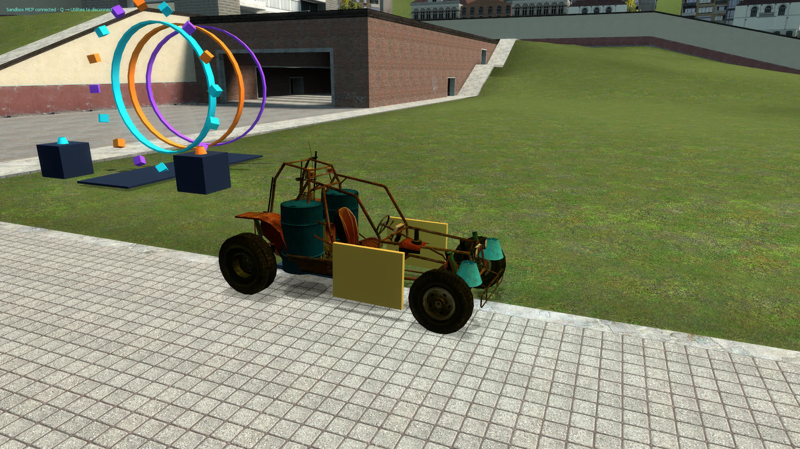

# Sandbox MCP

An original Workshop-compatible Garry's Mod addon and portable MCP companion.
Build scenes and contraptions, inspect the real game, test physics, capture the
result and undo changes through useful structured tools.

**0.1.0 beta.** [Steam Workshop](https://steamcommunity.com/sharedfiles/filedetails/?id=3839989108) · [Download the Windows companion](https://github.com/skulitom/sandbox-mcp/releases/latest) and follow the [setup guide](docs/INSTALL.md).

[Watch the showcase](https://www.youtube.com/watch?v=30DsajKY70I) ·
[Installation](docs/INSTALL.md) · [Validation and limits](docs/VALIDATION.md) ·
[Workshop listing](docs/WORKSHOP.md) · [Design](docs/DESIGN.md)

The game addon is pure Lua. The companion runs outside the game and exposes
standard MCP over stdio using the official Rust SDK. No game DLL, localhost
network bypass, API key, or model-specific code is required by the bridge.
An MCP-capable AI client supplies the model.

The addon is disabled until the host connects through Q > Utilities >
Sandbox MCP > Connection. Disconnect revokes the current connection. Building tools own their
creations; inspecting an existing prop does not authorize modifying it.

Original code: MIT. Game assets remain owned by their authors; no game assets
are redistributed by this project.

The companion exposes 17 tools: connection diagnostics, model/vehicle/NPC
catalogs, world inspection, placement traces, batched scene creation, edits,
physical connections, targeted undo, build cleanup, temporary camera views,
game screenshots, physics observation, recent operation events, and optional
Wiremod port inspection, signal wiring/disconnection and source control.

With [Wiremod](https://steamcommunity.com/sharedfiles/filedetails/?id=160250458)
installed, create buttons, constants, gates, thrusters, indicators, screens,
speedometers and GPS sensors. The AI can inspect live signals, wire a circuit,
change its controls and undo individual changes. Wiremod remains optional; it
is not bundled. Expression 2 and arbitrary Wire components are not supported yet.

The setup wizard supports Codex, Claude Desktop, Cursor, GitHub Copilot/VS Code,
and the older VS Code Local harness. It preserves other settings and backs up
existing configuration files. Other stdio MCP clients can use `sandbox-mcp config`.




These are native captures. Both examples were built through the public MCP tools,
with transcripts and timings retained. Reproduce them with `tools/dogfood_scene.py`
and `tools/dogfood_rover.py` against a connected `gm_construct` session. Python is
a development/test dependency only; users run the portable Rust executable.

## Build and test

```powershell
cargo build --release --locked
cargo test --locked
cargo clippy --all-targets -- -D warnings
python tests/setup_evaluation.py
python tests/protocol_evaluation.py
# Requires a connected Sandbox session:
python tests/native_evaluation.py
python tests/transport_evaluation.py
# With optional Wiremod installed:
python tests/wire_evaluation.py
```

`tools/package.ps1` validates the addon with GMod's own `gmad.exe` and prepares the
local GMA and Windows ZIP. `tools/third_party_notices.py` collects dependency
license notices for the companion. The private Anode package fixture in `tests/`
is never included in the Workshop package. Dependency licenses are included with
the portable download.
